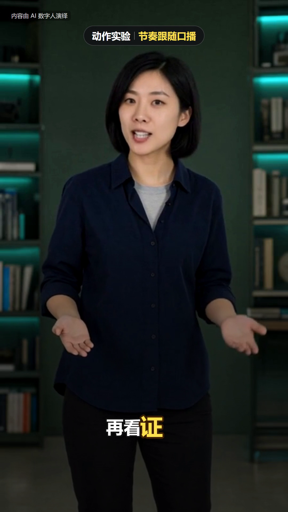

# Digital Human Koubo Local

**v0.1.0 · 实验验证版** — 本地 ComfyUI H3 原声口播、动作 LoRA，与原版 Remotion 字幕及包装。

本项目基于 [andyhuo520/digital-human-koubo](https://github.com/andyhuo520/digital-human-koubo) 改造，保留原模板、包装组件、语音核对、字幕对齐与修音流程。新增本地生成适配、随仓库提供的执行器与工作流、Windows 初始化和台词手势配置。不是从零重写剪辑引擎。

## 支持范围

| 能力/样式 | v0.1 状态 |
|---|---|
| B 竖屏口播、逐字字幕、卡片 | 已真实生成并渲染验证 |
| H3 首帧普通20步 / Turbo8步 | 已真实验证 |
| 人体动作 LoRA、台词手势、中景双手可见 | 已真实验证，动作非逐字帧锁定 |
| 本地Qwen参考图生成 | 已真实验证 |
| C 横屏发布解读 | 原参考实现保留，待验证 |
| A 长篇解说、D 教程、E 多主播/多语言 | 原实现保留，待验证；A另需finance-explainer引擎 |
| Ref2VA工作流 | 随仓库提供，未纳入本轮端到端验收 |
| Linux/macOS GPU服务管理 | 未验证；当前实测为Windows/NVIDIA |

**v0.1.0 之后的本地工作区验证：**A 已完成全屏转小窗短片；C 已验证开场及侧栏片段，并修复开场漏放人声；D 已验证开场和步骤小窗；E 已用两位本地虚构主播验证中英切换。新增的真人写实 LoRA 完成同条件对照，本次风格变化较轻，保留为可选项。完整长片及 E 其他语种仍待验证，详见 [验证记录](docs/VALIDATION.md)。

默认本地分支不需要 Renoise 账号或积分。原云端分支保留为显式选项，尚未重新实测。模型使用、Remotion及其他依赖遵循各自许可证，见 [第三方说明](THIRD_PARTY.md)。

## 演示

[观看约7秒动作演示](docs/media/gesture-demo.mp4)：手掌展开、解释手势、头肩变化、句尾收势。



测试设备为 RTX 3060 12GB、32GB内存、ComfyUI 0.40.0。动作片段源6.58秒、448×800、20步、LoRA权重0.5，总执行约23分21秒。成片1080×1920为放大输出。构图、提示词与LoRA共同影响结果，不能保证每个字精确落拍。[验证记录](docs/VALIDATION.md)

## 安装

前提：已有能运行原生 H3 节点的 ComfyUI、相应模型、ffmpeg/ffprobe、Node.js，以及 Python 3.12（本版验证版本）。本仓库不包含模型，不自动改动现有 ComfyUI，也不自动安装或升级系统软件。

```powershell
git clone https://github.com/laiyulaiyu/digital-human-koubo-local.git
cd digital-human-koubo-local
python -m venv .venv
$PY = (Resolve-Path .venv/Scripts/python.exe).Path
& $PY -m pip install -r requirements-lock.txt
$S = (Resolve-Path skills/digital-human-koubo/scripts).Path
& $PY -X utf8 "$S/configure.py" --comfy-root 'C:/ComfyUI' --python 'C:/ComfyUI/python/python.exe' --asr-model 'C:/Models/faster-whisper-large-v3'
& $PY -X utf8 "$S/local_media.py" doctor
```

请将最后一行配置中的三个示例路径换成自己的实际路径：`--python` 是运行已有 ComfyUI 的解释器，不是必须使用这里的示例位置。`--asr-model` 可指向完整的本地 faster-whisper 模型目录；已有缓存时也可省略，由本地搜索发现。ffmpeg/ffprobe 默认在PATH中；也可配置 `--ffmpeg` / `--ffprobe` 的绝对路径。

configure 会写入被Git忽略的 `skills/digital-human-koubo/config/local.json`。执行器与六份API工作流已包含在本仓库，无需安装原作者工作机上的其他Skill。相对路径按配置文件所在目录解析。

模型文件名、放置目录和下载来源见 [模型准备](docs/MODELS.md)。`doctor --profile all` 会额外检查可选的Qwen、Ref2VA和Turbo模型。doctor是检查，不会自动下载模型或触发生成。

## 跑通示例

```powershell
# $S 保持为上面设置的绝对脚本目录
$W = (Resolve-Path work).Path
New-Item -ItemType Directory -Force "$W/demo" | Out-Null
Copy-Item examples/gesture/* "$W/demo/" -Recurse
& $PY -X utf8 "$S/build_tasks.py" "$W/demo/script.json" "$W/demo/tasks.json" --purpose 'explaining in a natural human motion demonstration, mvmt'
& $PY -X utf8 "$S/local_backend.py" run "$W/demo/tasks.json" --dry-run
# 已准备好H3和动作LoRA后，运行真实生成（普通20步可能耗时较长）
& $PY -X utf8 "$S/local_backend.py" run "$W/demo/tasks.json"
& $PY -X utf8 "$S/local_media.py" server stop
& $PY -X utf8 "$S/new_edit.py" huazi-916 "$W/demo/edit"
Copy-Item "$W/demo/edit.json" "$W/demo/edit/src/edit.json" -Force
& $PY -X utf8 "$S/finish_local.py" "$W/demo"
Set-Location "$W/demo/edit"
npx remotion render src/index.ts Huazi ../final.mp4 --concurrency=1 --gl=swangle
```

示例使用可选动作LoRA；若未下载，可从script.json删除loras数组，继续用相同台词和手势提示测试基础模型。正式生成前先审看参考图与提示词，生成后检查真实台词、手部、口型与字幕遮挡。`--dry-run` 仅准备图结构，不代表已经生成样片。

更完整的字段、断点续查与LoRA规则见 [本地工作流说明](skills/digital-human-koubo/references/local-comfyui.md)。Agent使用入口为 [SKILL.md](skills/digital-human-koubo/SKILL.md)。

## 开发与发布验证

```powershell
& $PY -m unittest discover -s skills/digital-human-koubo/tests -v
```

CI运行代码与可移植性检查，不运行GPU生成。真实样片验证和干净环境安装/结构检查分开记录，不将单元测试通过解释为所有样式已支持。

## 来源与许可

原项目基线：`5fa9b19f52fb8920c83567468fa30e8391b8c503`。原作者MIT版权声明与LICENSE保留；上游README归档于 [docs/UPSTREAM_README.md](docs/UPSTREAM_README.md)。本地执行器的来源及Apache-2.0 notices见 [licenses](licenses)。

`examples/gesture/assets` 和 `docs/media` 中的测试主播为本地生成的虚构人物，不是上游作者的数字人。上游自有形象和演示的使用约定见 [NOTICE.md](NOTICE.md)。模型权重、ASR模型、缓存和本机配置不随源码发布。
